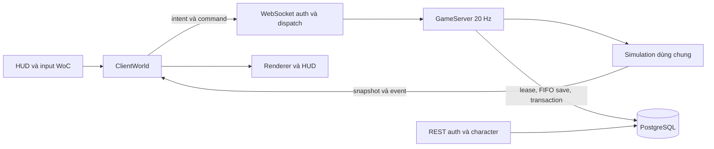

# Luồng multiplayer kế thừa từ WoC

Mục tiêu: giữ nguyên một simulation cho browser offline, authoritative server và headless.
Không thay server bằng một backend demo, không tự viết lại auth, protocol hoặc persistence.

## Startup

`pnpm dev` -> `scripts/dev.mjs` -> env local riêng -> Compose PostgreSQL 16 -> build
client/server/editor/admin -> `server/main.ts` và static/proxy `scripts/serve.mjs`.
Server: `startServer` -> `loadConfig` -> DB readiness -> `ensureSchema` -> restore world
state -> `GameServer.start` -> HTTP/WS. Schema, migration, cache, retention và shutdown
vẫn do backend gốc sở hữu.

`RPG_WORLD=placeholder` chỉ thay construction input qua `server/product_world.ts` và
`server/sim_boot_config.ts`. Server/client cùng đọc `src/mit_test/world.ts` và collider
manifest. `setActiveWorldContent` phải chạy cùng `cfg.world`, vì terrain registry
không tự cập nhật chỉ nhờ truyền `cfg.world`.

Không bật compulsory tutorial, world boss at boot, Mirefen muster hoặc rift portals
cho map trống. Host clock, UUID minting, raid reset, storage admission và courier
callbacks của server vẫn giữ nguyên. World protocol của fork là epoch 48001;
không dùng client WoC upstream để vào world fork này.

## Tài khoản, nhân vật và vào world

1. UI gốc ở `src/main.ts` dùng `Api` trong `src/net/online.ts`.
2. `Api.register/login` -> `server/auth_routes.ts` -> scrypt/token, guard, moderation.
3. `Api.realms/characters` -> realm và roster; `CharacterRequests.create` gọi route
   gốc trong `server/characters.ts`. Bootstrap nhân vật mới đặt tại spawn của product world.
4. `enterWorld` tạo `ClientWorld`; socket đầu tiên gửi `worldAuthMessage`.
5. `server/ws_auth.ts` kiểm tra protocol, token, ownership, moderation, admission cap,
   character lease và persisted state trước `GameServer.join`.
6. `hello` cấp pid/seed và negotiation; `watchWorldEntry` gọi `startGame` với
   `ClientWorld` qua `IWorld`. Renderer/HUD không ghi trực tiếp kết quả gameplay.

`hello` không truyền toàn bộ map. Vì vậy thay địa hình/collider phải build và deploy
**cả client lẫn server**. Loader từ chối manifest collider khác với cấu hình đã build.
Editor playtest dùng document riêng ở offline, không tự sửa map của realm đang chạy.

## Input, combat và đồng bộ

`Input` -> movement glue/outbox trong `src/game`/`src/net` -> frame intent/command ->
`GameServer.handleMessage` -> validation và movement timeline -> shared `Sim.tick`.
Combat, loot, quest credit, inventory và economy quyết định ở server. Server gửi
interest-scoped snapshots/events; `ClientWorld` merge delta, reconcile/predict movement;
renderer và HUD đọc `IWorld`. Cơ chế movement v1/v2 và snapshot được giữ nguyên.

## Mất kết nối, save và shutdown

- Socket đứt chưa phải leave: `linkdead.ts` giữ phiên trong grace window, reconnect
  qua auth gốc có thể resume cùng pid.
- Character load lease có heartbeat/nonce. Ownership và lease ngăn load/save chồng phiên.
- Live saves đi qua FIFO theo nhân vật và lease-fenced SQL. Không thêm file JSON save.
- Autosave 30 giây, leave/takeover và shutdown đều dùng pipeline gốc.
- SIGINT/SIGTERM đợi lưu/drain/release trước khi đóng pool. `pnpm dev` chuyển signal
  đến game server, không thay bằng `kill -9`.

## Các hệ thống đã giữ mã để tiếp tục phát triển

| Nhóm | Nơi chính | Trạng thái |
| --- | --- | --- |
| Combat, skills, talents, quest, item, crafting, farming | `src/sim`, `src/world_api`, `server/game.ts` | Giữ mã gốc; nội dung map mẫu tối giản |
| Party, guild, friends, chat, moderation | `server/social*`, `server/moderation*`, world facets | Giữ backend; chưa kiểm thử toàn bộ tính năng |
| Inventory, bank, mail, market, vault | các module domain server và simulation | Giữ save/transaction/ledger gốc |
| Dungeon, arena, PvP, world events | simulation và các service server | Giữ mã; cần map/content/asset riêng để sử dụng đầy đủ |
| Auth, lease, reconnect, snapshot | `server/auth*`, `ws_auth`, `linkdead`, `src/net` | Đã kiểm thử core |
| Admin | `src/admin`, admin routes | Build đã qua; chưa cấp tài khoản admin hay kiểm thử toàn bộ UI |
| Editor | `src/editor`, editor entry | Build đã qua; đang nối world mẫu, asset browser còn catalog legacy |
| Headless/Python | `headless`, `python` | Giữ source; Node headless build đã qua |
| Discord bot | `bot` | Build đã qua; không chạy/kết nối Discord |
| Desktop/mobile | `electron`, `android`, `ios` | Giữ mã shell/config; chưa build native, cần identity/icon/SDK riêng |
| Deployment và engineering scripts | `deploy`, `scripts`, `upstream` | Giữ mã tham khảo; không chạy deployment upstream |

## Những gì chưa được xác nhận

Hai người chơi local không chứng minh khả năng chịu tải production. Chưa có load test,
kiểm thử toàn bộ campaign/domain, production credentials, email/OAuth/store/wallet,
TLS/CDN/backup/restore hay native signing. Private bot detector không được sao chép;
build dùng public no-op stub có sẵn của WoC. Muốn anti-bot production phải triển khai
qua contract đó. Reown Community runtime vẫn không được cài trong fork này.

Trước khi phát hành cần cấu hình các guard của backend gốc theo môi trường, đổi brand,
legal pages và liên kết dịch vụ, thay catalog asset, rà dependency và chạy các gate phù hợp.
Không bật `ALLOW_DEV_COMMANDS` trong production.
